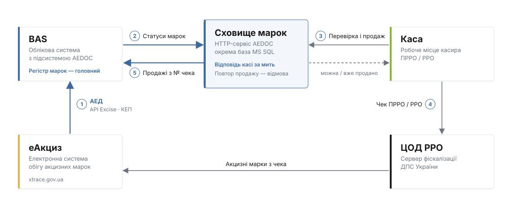

# Каси: перевірка акцизної марки і продаж

Служба AEDOC тримає актуальні статуси акцизних марок для кас ПРРО і РРО. Каса сканує марку і штрихкод товару, за мить отримує відповідь «можна продати» або причину відмови, а після фіскалізації чека повідомляє про продаж — облікова система отримує його з номером чека.

Касова програма працює однаково з усіма способами підключення — змінюється лише адреса.

## Схема роботи

1. **Статуси з еАкциз.** Документи АЕД, сканування упаковок і переміщення змінюють статус акцизної марки в обліковій системі.
2. **Передача в сховище.** Облікова система одразу передає зміни в сховище марок служби. Коли змін немає, вона однаково повідомляє, що дані актуальні.
3. **Перевірка на касі.** Каса сканує марку і штрихкод товару, отримує відповідь і після чека фіксує продаж.
4. **Чек ПРРО / РРО.** Чек з акцизними марками йде на сервер фіскалізації ДПС, звідти марки потрапляють в еАкциз.
5. **Продажі в облік.** Облікова система забирає продажі: марка отримує статус «Погашено ЕМ» з номером чека.

## Три способи підключити касу

| | Онлайн до сервера обліку | Клієнт каси (хмара) | Локальний режим |
|---|---|---|---|
| Для кого | каси в тій самій мережі, що й сервер обліку (офіс, магазин при складі) | віддалені магазини з окремим інтернетом | магазин без облікової системи, одна каса |
| Що ставити на касовий комп'ютер | нічого | AEDOC, режим «Каса (хмара)» | AEDOC, режим «Каса (локальний режим)» |
| Адреса для каси | `http://<сервер>:8766` (з мережі — з токеном) | `http://127.0.0.1:8766` | `http://127.0.0.1:8766` |
| Без зв'язку | ні — потрібна мережа до сервера | так — залишок з останнього оновлення, продажі чекають | так |
| Що бачить каса | усі акцизні марки сховища (всі точки) — свою точку каса може вказати | лише свою точку | лише свій об'єкт ЕО |

### Онлайн до сервера обліку {#online}

Потрібне сховище марок MS SQL на сервері обліку ([режим «Сервер обліку»](../rezhymy.md#server)).

1. У треї сервера: **«Налаштування»** → **«Додатково»** → увімкніть **«Доступ кас з мережі»** → **«Згенерувати»** токен → **«Зберегти»**. Служба перезапуститься й сама відкриє порт у брандмауері Windows.
2. **«Скопіювати»** токен і передайте його налаштувальнику касової програми разом з адресою `http://<ім'я або IP сервера>:8766`.
3. На сторінці **«Стан»** трея з'явиться рядок **«Каси онлайн»** з адресою.

!!! note ""
    Каса на самому сервері обліку звертається на `http://127.0.0.1:8766` без токена або кладе чеки в **«Папку inbox»** (вказується там само, у «Додатково»). Доступ з інтернету без VPN не передбачено — для віддалених магазинів є клієнт каси.

### Клієнт каси і локальний режим

Налаштування — у [Встановленні](../vstanovlennia.md): підключення каси кодом з облікової системи або токен еАкциз і об'єкт ЕО.

## Основні переваги

<strong>Перевірка марки за мить</strong>
Каса сканує марку і штрихкод товару і одразу бачить, чи можна продати. Без очікування облікової системи і без запитів до еАкциз.

<strong>Марка саме від цього товару</strong>
Служба звіряє штрихкод товару з товаром акцизної марки: марку від горілки на пачці сигарет каса не продасть.

<strong>Немає подвійних продажів</strong>
Щойно марку продано, служба це фіксує. Спроба пробити її ще раз — на цій чи іншій касі — отримає відмову з номером першого чека.

<strong>Жоден продаж не губиться</strong>
Кожен продаж повертається в облікову систему з номером чека. Розбіжності (повторний продаж, марка іншої точки) потрапляють у протокол обміну для розбору.

<strong>Каса не залежить від облікової системи</strong>
Оновлення, перезапуск чи важкий обмін з еАкциз в обліковій системі не зупиняють продажі.

<strong>Завжди видно, чи дані свіжі</strong>
Облікова система постійно повідомляє, що дані актуальні. Якщо зв'язок зник, каса отримує ознаку «дані застарілі».

## Перехід на сховище марок

Облікова система переходить на роботу зі сховищем MS SQL через **майстер міграції**: він вивантажує всі акцизні марки в сховище, звіряє дані і лише після успішної перевірки дозволяє касам продавати через службу. Поки майстер працює, продажі кас не губляться: служба приймає їх і проводить після завершення міграції. Зворотний перехід — тим самим майстром.

<a class="promo" href="rozrobnykam/">
Для розробників
<strong>API для касового ПЗ (ПРРО / РРО)</strong>
Перевірка марки з штрихкодом товару, пакетна перевірка, фіксація продажу, папка inbox, коди відповідей, токен.
</a>
